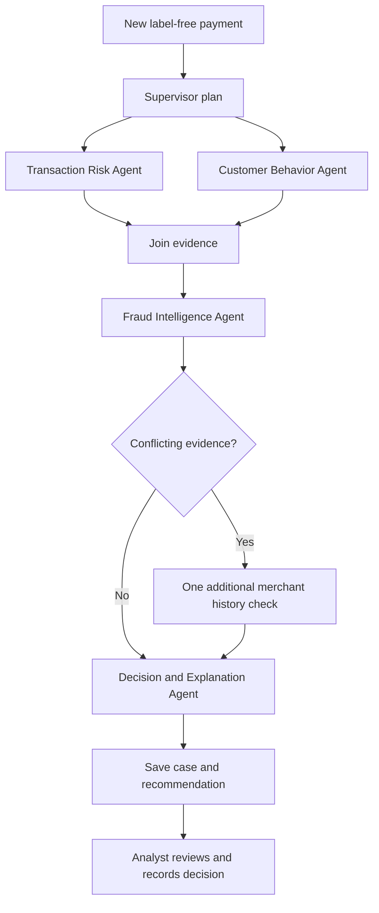

# FinSentry — active architecture

The analyst interface has Overview, Review queue and Investigate payment pages. It prioritizes pending/escalated cases, explains findings in everyday language and records explicit reviewer decisions separately from automated assessments.

Model: LightGBM with shared offline/online causal features, separate sigmoid calibration and validation-selected threshold. The classifier produces a risk estimate; deterministic combined policy selects clear/flag/escalate. Groq explains supported findings, with structured validation and factual fallback. No LLM selects a numeric confidence percentage or executes banking actions.

Source history: read-only SQLite index, model/source manifest validation, strictly prior timestamps. Fraud cases: development outcomes only, simulated 24-hour delay, exact customer/merchant links. No test labels enter history or intelligence. Incoming payments, investigations and append-only reviewer decisions live in project MySQL.

Cases refresh every 20 seconds in the visible UI. In-progress selected cases poll with a two-minute bound; jobs continue server-side. Up to eight jobs are accepted and two run concurrently in one process. Restart marks unfinished investigations failed rather than pretending to resume them. UI queue status respects the most recently ordered stored review: follow-up/escalation remain open; analyst clearance removes the attention flag.

Model test F1 is 0.7990 on simulated data. This does not establish complete-policy or real-world accuracy. No production authentication, automatic payment blocking or live financial feed is implemented.
